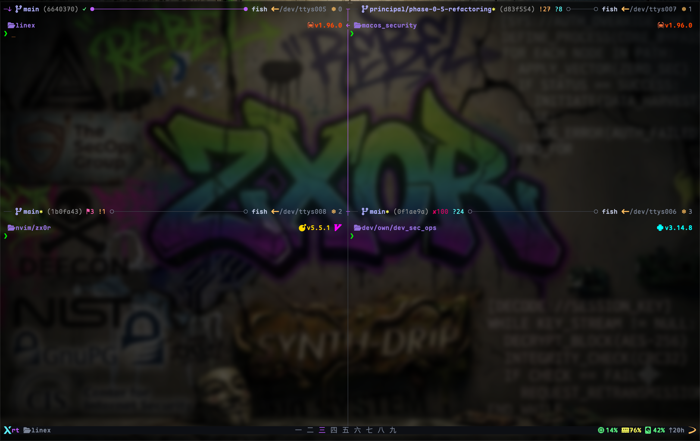

<p align="center">
  <a href="https://github.com/zx0r/xw/releases">
    
  </a>
  <a href="LICENSE-MIT">
    
  </a>
  <a href="https://www.rust-lang.org/">
    
  </a>
</p>

<p align="center">
  
</p>

---

### Installation

```bash
# Cargo (crates.io)
cargo install xw

# Homebrew (macOS / Linux)
brew install zx0r/tap/xw

# Build from source (LTO fat, stripped)
gh repo clone zx0r/xw
cd xw && just release
```

---

### Integration

```bash
# TOP Bar pane-border-format
set -gF @mod_git "xw git"

# Bottom Bar
set -gF @mod_hw "xw cpu mem ssd uptime"
set -g @mod_right "#(#{E:@mod_hw}) #{E:@zoom}"
```

---

### [ l i n e x ]

<p align="center">
  
</p>

```shell
xw [WIDGET] [OPTIONS]

[✓] zero-allocation stack formatting
[✓] sub-millisecond telemetry probes
[✓] native tmux and ANSI dialects
[✓] zero runtime dependencies

fast telemetry → rendered instantly for tmux and status lines
```

---

### License

Dual-licensed under [MIT](LICENSE-MIT) or [Apache 2.0](LICENSE-APACHE).
